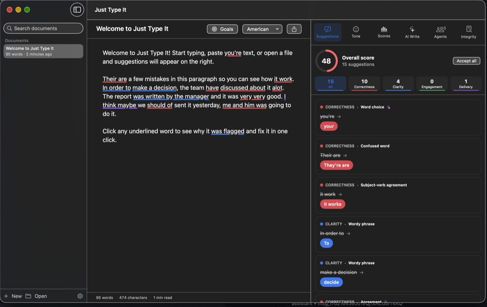

<p align="center">
  
</p>

<h1 align="center">Just Type It</h1>

<p align="center">
  <b>A free, private AI writing assistant for Mac.</b><br>
  Grammar, clarity, tone, rewrites, plagiarism checks and AI writing tools in one native app.<br><br>
  Created by <b>Stefano Roman Gunness</b>
</p>

<p align="center"></p>

---

Just Type It checks your writing as you type. It underlines mistakes, explains each one, and fixes it in one click. It also helps with clarity, tone and style, and it works in any app on your Mac.

The checking happens **on your Mac**. It uses Apple's built-in spelling and grammar engine, a large set of hand-written rules, and Apple Intelligence's on-device language model. There's no account, no subscription and no word limit. The only feature that goes online is the web plagiarism check, and only when you click it.

## Features

### Grammar and correctness
- **Real-time checking** with colored underlines: red for Correctness, blue for Clarity, green for Engagement, purple for Delivery.
- **Subject-verb agreement**: *she go* → *she goes*, *me and him was* → *he and I were*.
- **Verb tense and verb forms**: *yesterday she go* → *went*, *should of* → *should have*.
- **Sentence structure**: run-on sentences, sentence fragments and comma splices.
- **Confused words**: their/there/they're, your/you're, its/it's, affect/effect, then/than, lose/loose, to/too, who's/whose.
- **Punctuation**: missing apostrophes, commas after transition words, double punctuation, spacing, hyphens in compound numbers and prefixes, missing end punctuation.
- **Modifiers**: possible dangling and misplaced modifiers.
- **Pronouns**: case (*between you and I*), who/whom.
- **Articles**: *a apple* → *an apple*, *an university* → *a university*.
- **Prepositions**: *discuss about*, *depend of*, *arrive to*, *married with*.
- **Dialects**: American, British, Canadian, Australian and Indian English.
- **AI full-sentence check**: Apple Intelligence proofreads each sentence, and Just Type It turns the corrections into separate, clickable suggestions (marked ✨).

### Style and clarity
- **Full-sentence rewrites**: three AI alternatives for long or awkward sentences.
- **Conciseness**: 50+ wordy phrases (*in order to* → *to*) and 40+ redundancies (*end result* → *result*).
- **Passive voice**, with an active-voice rewrite when the doer is named.
- **Tone detection**: confident, friendly, formal, optimistic, worried and more, plus formality and sentiment meters.
- **Tone changes**: rewrite text to sound more confident, friendly, formal, diplomatic, persuasive, empathetic and more.
- **Vocabulary**: replacements for vague and overused words, and for words repeated within a paragraph (uses the macOS thesaurus).
- **Inclusive language**: suggests alternatives to outdated, biased or ableist terms.
- **Confidence**: flags hedging such as *I think maybe* or *just wanted to*.
- **Consistency**: spelling variants (*e-mail* / *email*), numbers, date formats, the Oxford comma and quote styles.

### Guidance and customization
- **Goals**: set intent, audience, formality and domain (academic, business, technical, creative and more) for each document.
- **Explanations**: every suggestion says why it was flagged.
- **Scores**: an overall score, scores for Correctness, Clarity, Engagement and Delivery, readability (Flesch score and grade level), vocabulary stats, reading and speaking time, and your progress over time.
- **Personal dictionary** for names, brands and jargon.

### Integrity
- **Plagiarism check**: searches the web for your sentences, downloads the matching pages and compares them with your text. It also checks your other documents and any source you paste. Matches are highlighted, and you can add quotation marks or create a citation for each one.
- **AI content detector**: estimates how AI-like the text reads, using sentence rhythm, stock AI phrases and how personal the voice is, plus a second opinion from the on-device model.
- **Citation generator** in APA 7, MLA 9 and Chicago. It can fill in the details from a URL, insert in-text citations and build a reference list.

### Generative AI (on-device)
- Write drafts and emails from a short prompt.
- Improve, shorten, expand, simplify, summarize, outline, brainstorm, write a reply, keep writing, or suggest titles.
- Chat with an assistant about your document.

### AI agents
- **Proofreader**: polishes the whole text in one pass.
- **Paraphraser**: eight modes (Standard, Fluent, Formal, Simple, Creative, Shorten, Expand, Academic).
- **Reader Reactions**: predicts your audience's main takeaway, their questions and where they might lose interest.
- **AI Grader**: a grade and feedback, using your rubric if you add one.
- **Humanizer**: makes AI-sounding text read naturally.
- **Expert Review**: feedback on substance and logic from a domain expert's point of view.

### Works everywhere on your Mac (always on)
- **Checks as you type in every app.** Just Type It runs in the menu bar, starts automatically when you log in, and underlines mistakes right inside the text box you're typing in: Outlook, Apple Mail, Gmail and other websites in Chrome, Safari or Edge, Microsoft Word, Pages, Notes, Messages, Slack, Teams, Notion and more. Click an underline to see the fix and explanation, then apply it in one click without leaving the app. A colored badge in the corner of the text box shows how many suggestions there are.
- Tone is adjusted per app: emails are checked as neutral/professional, chat apps as casual.
- Never checks password fields, search and address bars, or Terminal/code editors. Email addresses, links, @mentions and file paths are ignored. Pause it for any app from the menu bar icon.
- **Google Docs:** Docs draws its text in a way other apps can't read. Turn on *Tools → Accessibility → Turn on screen reader support* in Google Docs, or use ⌃⌥G.
- **⌃⌥G in any app** (Mail, Slack, Notion, Word, Pages, Google Docs in Chrome or Safari, and others): select text, press the shortcut, fix the suggestions, then click **Replace in app**.
- **Services menu**: right-click selected text → Services → *Check with Just Type It*.
- **Documents**: open and export .txt, .md, .rtf and .docx files. Documents are saved automatically, and you can search them.

### Teams and consistency
- **Style guide rules**: words to avoid and what to use instead, with notes.
- **Brand tone**: a description that shapes every AI rewrite, plus a one-click *Match brand tone* button.
- **Snippets**: type a trigger such as `;sig` and it expands into the full text.

## Requirements

| | |
|---|---|
| Mac | Apple silicon (M1 or newer) |
| macOS | 26 (Tahoe) or newer |
| Apple Intelligence | Recommended. It powers AI checks, rewrites, tone changes, the AI writing tools and the agents. All rule-based checks work without it. |

## Install

Open **Terminal** and paste:

```bash
curl -fsSL https://raw.githubusercontent.com/stefanoromang/just-type-it/main/install-mac.sh | zsh
```

Or download this repository and run `zsh install-mac.sh`.

The installer builds the app on your Mac and puts it in `~/Applications`. If Apple's free Command Line Tools aren't installed yet, it starts their installer; run the command again when that finishes.

To check text **in other apps**, allow Just Type It under System Settings → Privacy & Security → **Accessibility** (the app asks on first launch). It then runs in the menu bar and starts automatically at login.

## Privacy

- In other apps: text is read through macOS Accessibility only from the focused text box, checked on your Mac, and never stored or sent anywhere.
- Spelling and grammar: Apple's on-device `NSSpellChecker` plus the app's own rules.
- AI features: Apple's on-device Foundation Models (Apple Intelligence).
- Plagiarism check: only when you click **Check web**. It sends your longest sentences as search queries and downloads the pages it finds. **Offline only** compares just your documents and pasted sources.
- No servers, no analytics, no accounts. Documents and settings are stored in `~/Library/Application Support/JustTypeIt`.

## Build from source

```bash
git clone https://github.com/stefanoromang/just-type-it.git
cd just-type-it
./build-app.sh
```

Run the built-in checker tests with `.build/release/JustTypeIt --self-test` (add `--ai` to test the Apple Intelligence features too).

The app is plain Swift and SwiftUI with no third-party dependencies:

| File | What it does |
|---|---|
| `RuleEngine.swift` | System spelling and grammar, pattern rules, mechanics, sentence structure |
| `RuleData.swift` | Grammar rules: confused words, agreement, pronouns, articles, prepositions |
| `StyleChecks.swift` / `StyleData.swift` | Wordiness, passive voice, hedging, inclusive language, engagement, dialect, consistency, style guide |
| `AIEngine.swift` / `WordDiff.swift` | On-device AI check, rewrites, generation and agents |
| `Metrics.swift` | Scores, readability and tone detection |
| `Integrity.swift` | Plagiarism check, AI detection, citations |
| `EditorModel.swift` / `TextEditorView.swift` | Live checking, underlines, click-to-fix |
| `MainView.swift`, `Panels.swift`, `AIPanels.swift`, `IntegrityPanel.swift` | User interface |
| `Everywhere.swift` | Always-on checking and underlines inside other apps |
| `QuickCheck.swift` | ⌃⌥G check in any app |
| `LoginItem.swift` | Launch at login |
| `Store.swift` / `SettingsView.swift` | Documents, settings, dictionary, snippets, style guide |

## Uninstall

```bash
zsh uninstall-mac.sh
```

## Author

**Stefano Roman Gunness** designed and created Just Type It.

## License

[MIT](LICENSE) © 2026 Stefano Roman Gunness.
