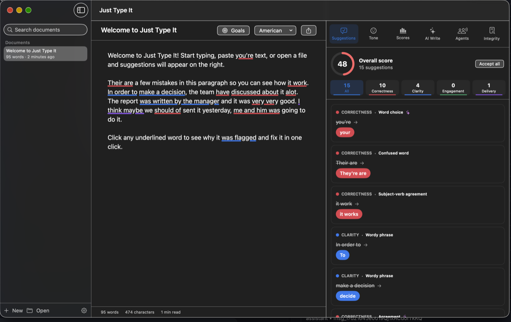

<p align="center">
  
</p>

<h1 align="center">Just Type It</h1>

<p align="center">
  <b>A free, private AI writing assistant for Mac and Windows.</b><br>
  Grammar, clarity, tone, rewrites, plagiarism checks and AI writing tools in one native app.<br><br>
  Created by <b>Stefano Roman Gunness</b>
</p>

<p align="center"></p>

---

Just Type It checks your writing as you type. It underlines mistakes, explains each one, and fixes it in one click. It also helps with clarity, tone and style, and it works in any app on your Mac or Windows PC.

The checking happens **on your Mac**. It uses Apple's built-in spelling and grammar engine, a large set of hand-written rules, and Apple Intelligence's on-device language model. There's no account, no subscription and no word limit. The only feature that goes online is the web plagiarism check, and only when you click it.

## Features

### What's new in 1.4 — more accurate, safer, fully reviewed
- **Catches more real mistakes.** A new set of 46 everyday business-writing errors is now caught in full: *send me there contact details*, *for you're help*, *whose going*, *Lets meet*, *since five years*, *the amount of people*, *will effect everyone*, *very unique*, and comma splices like *Thank you for your email, I will review it today*. The original 64-error set is still caught in full.
- **Fewer false alarms.** A set of 51 tricky but correct sentences (*an MBA*, *a one-time fee*, *assess the risks*, *the most honest*, *If you need anything else, please let me know*, *None of the files were…*, *that that*, *If I were you*) gets no grammar or spelling flags. "The team are…" is accepted in British, Australian, Canadian and Indian English.
- **Every source file reviewed** on Mac and Windows. Fixed:
  - Rewrite and Quick Check could paste into the wrong window or insert twice when an app was slow. They now wait until your app is really in front and verify the text; otherwise the result goes to your clipboard with a message.
  - Windows: Ctrl+Alt+G / Ctrl+Alt+R could type "©" in Word because the keys were still held. They now wait for the keys to be released.
  - Windows: Quick Check could garble text when suggestions overlapped; autocorrect moved the cursor to the end of the document; the clipboard could be restored too early in slow apps; old suggestions stayed after switching text boxes.
  - Mac: saved documents can no longer be lost if a file can't be read (a backup is kept); "Open Just Type It" reopens the editor after it was closed; several rare crashes in unusual apps; autocorrect no longer changes "i.e."; turning off checking stops all background work.
  - Windows: high-DPI screens, starting the app twice now shows its window, the startup choice is respected and removed on uninstall, and installer and portable versions share one version number.
- Automated checks now fail if accuracy drops or correct writing gets a grammar flag, on both platforms.

### What's new in 1.3 — rewrite anything, anywhere
- **Rewrite highlighted text in any app.** Highlight text in Outlook, Word, Excel, Gmail, Notes or anywhere else, then press **⌃⌥R** (Mac) / **Ctrl+Alt+R** (Windows) or click the ✨ button that appears next to the selection. Choose a style and pick from up to three versions; changes are highlighted, you can edit the result, and **Replace** puts it back exactly where the selection was.
- **17 styles:** Improve it, More professional, More casual, Shorter, Longer, More enthusiastic, Friendlier, More confident, Clearer, Simpler, More formal, More diplomatic, More persuasive, Fix grammar only, Bullet points, Summarize, Write a reply. You can also type your own instruction (“make it sound like a thank-you note”).
- On Mac, rewrites use Apple Intelligence on your Mac. On Windows, they use a free local model through [Ollama](https://ollama.com) if you install it; without it, Fix grammar, Improve, Professional, Formal, Casual, Shorter, Clearer and Confident still work with the built-in rules.
- **Tested in real apps on a Mac:** live grammar checking and rewriting were verified in Notes, Microsoft Word, Microsoft Excel (while editing a cell), Safari and Chrome (Gmail-style compose boxes), TextEdit, Teams and Outlook.
- Days, months and languages typed in lowercase (*thursday*, *january*) are flagged as capitalization, not spelling.
- The clipboard is fully restored after Quick Check and Rewrite, including images and rich text.

### What's new in 1.2 — faster and more proactive
- **15–20× faster checking.** Only the paragraph you're editing is re-checked; everything else is reused. Measured on an M-series Mac: a 120-word email checks in about 1 ms, a 700-word page in about 6 ms, and typing into a 2,800-word document costs about 26 ms per pause (it was 28 ms, 126 ms and 476 ms).
- **Autocorrect as you type**, in every app. Obvious typos (*teh*, *recieved*, *dont*, *i*) are fixed once you pause, and the cursor stays where you were typing. Real words that look like typos (*ill*, *wont*, *cant*) are never auto-changed. Undo with ⌘Z / Ctrl+Z, or turn it off in Settings or the menu bar.
- **Tone at a glance.** An emoji next to the suggestion badge shows how your message sounds (😀 friendly, 🎩 formal, 😟 worried…).
- **Green check when you're good.** A clean text box shows a green ✓ badge, so you can see Just Type It is checking.
- **Ready to send?** The suggestion panel and a toolbar button warn about mistakes, a mentioned attachment, harsh phrases (*per my last email*, *unacceptable*), words in capitals, and very long messages.
- **Synonyms on double-click** in the editor, with one-click replacement.
- Both Mac and Windows get these features, and they're covered by automated tests: the Mac self-test, the 40 Windows engine tests, and a live test that types into TextEdit.

### What's new in 1.1.1 — Outlook compatibility
- **Outlook compose detection fixed.** Outlook hosts its message body in a separate WebKit process. The checker now resolves that text area through system focus or a bounded, cycle-safe search of the active compose window, rather than requiring Outlook's app-level focus to expose it.
- **Verified corrections.** Outlook can report success without changing text. Corrections now verify the selected range, use paste for Outlook, and compare the entire resulting message with the expected text before counting a fix. The rest of the message and signature stay unchanged.
- **Safer Fix all.** Corrections run serially, stop on failure, and refuse to paste into a different app or field. Clipboard formats are restored unless you copied something new during the correction.
- Recipient fields, password fields, search boxes and inbox reading panes are not treated as compose bodies.
- Verified against a recipient-free test compose in the installed Outlook for Mac. This is a macOS desktop integration, not an Outlook mobile or Windows add-in.

### What's new in 1.1
- **Much stronger grammar engine.** It now catches **64 out of 64** common errors in the built-in test set, up from 25: *has went*, *I seen*, *did you saw*, *can speaks*, *look forward to meet*, *everyone have*, *each of the students have*, *more taller*, *most easiest*, *informations*, *a good news*, *I am agree*, *when I will arrive*, *I am living here since 2010*, *borrow you my pen*, *to John and I*, *suggested me to go*, *went to store* and more. On a 690-word sample of correct writing, it flags no grammar or spelling errors (only two optional passive-voice hints).
- **AI suggestions in every app.** Apple Intelligence checks the paragraph you're writing in Outlook, Mail, Word, Slack and other apps, in addition to the instant rule-based checks.
- **Suggestions panel with Fix all.** Click the colored badge in any text box to see every suggestion, fix them one by one, or fix them all at once.
- **Pause anytime.** Pause for 1 hour or until tomorrow, or turn it off for one app, from the menu bar.
- **First-run setup** walks you through the Accessibility permission.
- **Uses about 1% CPU when idle.** It checks quickly while you type and slows down when you stop.
- Email-friendly checks: missing comma after greetings (*Hi Team,*), capitalized words mid-sentence (*this email Is*), words in ALL CAPS, *T-shirt*, *different colors*, and list commas.
- Email addresses, links, @mentions, file paths and tech names (*Node.js*, *macOS*) are never flagged.

### Grammar and correctness
- **Real-time checking** with colored underlines: red for Correctness, blue for Clarity, green for Engagement, purple for Delivery.
- **Subject-verb agreement**: *she go* → *she goes*, *me and him was* → *he and I were*.
- **Verb tense and verb forms**: *yesterday she go* → *went*, *should of* → *should have*.
- **Sentence structure**: run-on sentences, sentence fragments and comma splices.
- **Confused words**: their/there/they're, your/you're, its/it's, affect/effect, then/than, lose/loose, to/too, who's/whose.
- **Punctuation**: missing apostrophes, commas after transition words, double punctuation, spacing, hyphens in compound numbers and prefixes, missing end punctuation.
- **Modifiers**: possible dangling and misplaced modifiers.
- **Pronouns**: case (*between you and I*), who/whom.
- **Articles**: *a apple* → *an apple*, *an university* → *a university*.
- **Prepositions**: *discuss about*, *depend of*, *arrive to*, *married with*.
- **Dialects**: American, British, Canadian, Australian and Indian English.
- **AI full-sentence check**: Apple Intelligence proofreads each sentence, and Just Type It turns the corrections into separate, clickable suggestions (marked ✨).

### Style and clarity
- **Full-sentence rewrites**: three AI alternatives for long or awkward sentences.
- **Conciseness**: 50+ wordy phrases (*in order to* → *to*) and 40+ redundancies (*end result* → *result*).
- **Passive voice**, with an active-voice rewrite when the doer is named.
- **Tone detection**: confident, friendly, formal, optimistic, worried and more, plus formality and sentiment meters.
- **Tone changes**: rewrite text to sound more confident, friendly, formal, diplomatic, persuasive, empathetic and more.
- **Vocabulary**: replacements for vague and overused words, and for words repeated within a paragraph (uses the macOS thesaurus).
- **Inclusive language**: suggests alternatives to outdated, biased or ableist terms.
- **Confidence**: flags hedging such as *I think maybe* or *just wanted to*.
- **Consistency**: spelling variants (*e-mail* / *email*), numbers, date formats, the Oxford comma and quote styles.

### Guidance and customization
- **Goals**: set intent, audience, formality and domain (academic, business, technical, creative and more) for each document.
- **Explanations**: every suggestion says why it was flagged.
- **Scores**: an overall score, scores for Correctness, Clarity, Engagement and Delivery, readability (Flesch score and grade level), vocabulary stats, reading and speaking time, and your progress over time.
- **Personal dictionary** for names, brands and jargon.

### Integrity
- **Plagiarism check**: searches the web for your sentences, downloads the matching pages and compares them with your text. It also checks your other documents and any source you paste. Matches are highlighted, and you can add quotation marks or create a citation for each one.
- **AI content detector**: estimates how AI-like the text reads, using sentence rhythm, stock AI phrases and how personal the voice is, plus a second opinion from the on-device model.
- **Citation generator** in APA 7, MLA 9 and Chicago. It can fill in the details from a URL, insert in-text citations and build a reference list.

### Generative AI (on-device)
- Write drafts and emails from a short prompt.
- Improve, shorten, expand, simplify, summarize, outline, brainstorm, write a reply, keep writing, or suggest titles.
- Chat with an assistant about your document.

### AI agents
- **Proofreader**: polishes the whole text in one pass.
- **Paraphraser**: eight modes (Standard, Fluent, Formal, Simple, Creative, Shorten, Expand, Academic).
- **Reader Reactions**: predicts your audience's main takeaway, their questions and where they might lose interest.
- **AI Grader**: a grade and feedback, using your rubric if you add one.
- **Humanizer**: makes AI-sounding text read naturally.
- **Expert Review**: feedback on substance and logic from a domain expert's point of view.

### Works everywhere on your Mac (always on)
- **Checks as you type in every app.** Just Type It runs in the menu bar, starts automatically when you log in, and underlines mistakes right inside the text box you're typing in: Outlook, Apple Mail, Gmail and other websites in Chrome, Safari or Edge, Microsoft Word, Pages, Notes, Messages, Slack, Teams, Notion and more. Click an underline to see the fix and explanation, then apply it in one click without leaving the app. A colored badge in the corner of the text box shows how many suggestions there are.
- Tone is adjusted per app: emails are checked as neutral/professional, chat apps as casual.
- Never checks password fields, search and address bars, or Terminal/code editors. Email addresses, links, @mentions and file paths are ignored. Pause it for any app from the menu bar icon.
- **Google Docs:** Docs draws its text in a way other apps can't read. Turn on *Tools → Accessibility → Turn on screen reader support* in Google Docs, or use ⌃⌥G.
- **⌃⌥G in any app** (Mail, Slack, Notion, Word, Pages, Google Docs in Chrome or Safari, and others): select text, press the shortcut, fix the suggestions, then click **Replace in app**.
- **Services menu**: right-click selected text → Services → *Check with Just Type It*.
- **Documents**: open and export .txt, .md, .rtf and .docx files. Documents are saved automatically, and you can search them.

### Teams and consistency
- **Style guide rules**: words to avoid and what to use instead, with notes.
- **Brand tone**: a description that shapes every AI rewrite, plus a one-click *Match brand tone* button.
- **Snippets**: type a trigger such as `;sig` and it expands into the full text.

## Mac and Windows

| Feature | Mac | Windows |
|---|---|---|
| Live underlines while you type in other apps (Outlook, Word, Teams, Chrome, Edge…) | ✅ | ✅ (UI Automation) |
| Suggestion badge, one-click fixes, Fix all | ✅ | ✅ |
| Grammar rules (107 shared rules, same `rules.json`) | ✅ | ✅ |
| Spelling | macOS spell checker | Windows spell checker (same one Office uses) |
| Clarity, tone, inclusive language, dialects, scores | ✅ | ✅ |
| Check selected text in any app | ⌃⌥G | Ctrl+Alt+G |
| Rewrite highlighted text in any app (17 styles, up to 3 versions) | ⌃⌥R or ✨ button | Ctrl+Alt+R |
| Editor window with suggestions and scores | ✅ | ✅ |
| Starts automatically, runs in the menu bar / system tray | ✅ | ✅ |
| Autocorrect obvious typos as you type | ✅ | ✅ |
| Tone emoji, green ✓ when clean, pre-send warnings | ✅ | ✅ |
| Synonyms on double-click | ✅ (editor) | — |
| AI rewrites in every style | ✅ Apple Intelligence | ✅ with Ollama (free, local); 8 styles work without it |
| AI agents, AI suggestions while typing | ✅ Apple Intelligence | Not yet |
| Plagiarism check, AI detector, citations | ✅ | Not yet |

Both apps use the same rule data, exported from the Mac sources to `windows/JustTypeIt.Core/rules.json`, and the same test sets. Both catch 64 out of 64 errors in `Tests/error-corpus.txt`.

## Requirements

**Mac**

| | |
|---|---|
| Mac | Apple silicon (M1 or newer) |
| macOS | 26 (Tahoe) or newer |
| Apple Intelligence | Recommended. It powers AI checks, rewrites, tone changes, the AI writing tools and the agents. All rule-based checks work without it. |

**Windows**: Windows 10 (version 2004) or Windows 11, 64-bit. No administrator rights needed.

## Install on Windows

Open **PowerShell** (a normal window) and paste:

```powershell
irm https://raw.githubusercontent.com/stefanoromang/just-type-it/main/install-windows.ps1 | iex
```

Or download `JustTypeIt-Setup-<version>.exe` (installer) or the portable zip from [Releases](https://github.com/stefanoromang/just-type-it/releases). Both install for your user only.

Just Type It then runs in the system tray (near the clock) and starts with Windows. Type in any app and mistakes are underlined; click an underline or the colored badge to fix them. Select text anywhere and press **Ctrl+Alt+G** for a quick check.

## Install on Mac

Open **Terminal** and paste:

```bash
curl -fsSL https://raw.githubusercontent.com/stefanoromang/just-type-it/main/install-mac.sh | zsh
```

Or download this repository and run `zsh install-mac.sh`.

The installer builds the app on your Mac and puts it in `~/Applications`. If Apple's free Command Line Tools aren't installed yet, it starts their installer; run the command again when that finishes.

To check text **in other apps**, allow Just Type It under System Settings → Privacy & Security → **Accessibility** (the app asks on first launch). It then runs in the menu bar and starts automatically at login.

## Privacy

- In other apps: text is read through macOS Accessibility only from the focused text box, checked on your Mac, and never stored or sent anywhere.
- Spelling and grammar: Apple's on-device `NSSpellChecker` plus the app's own rules.
- AI features: Apple's on-device Foundation Models (Apple Intelligence).
- Plagiarism check: only when you click **Check web**. It sends your longest sentences as search queries and downloads the pages it finds. **Offline only** compares just your documents and pasted sources.
- No servers, no analytics, no accounts. Documents and settings are stored in `~/Library/Application Support/JustTypeIt` (Mac) or `%LOCALAPPDATA%\JustTypeIt` (Windows).
- Windows: text is read through UI Automation only from the focused text box and checked on your PC. Password fields are never read.

## Build from source

```bash
git clone https://github.com/stefanoromang/just-type-it.git
cd just-type-it
./build-app.sh
```

Run the built-in checker tests:

```bash
.build/release/JustTypeIt --self-test                                   # core checks
.build/release/JustTypeIt --self-test --errors Tests/error-corpus.txt   # recall on 64 common errors
.build/release/JustTypeIt --self-test --corpus Tests/clean-corpus.txt   # false alarms on correct writing
.build/release/JustTypeIt --self-test --ai                              # Apple Intelligence features
zsh scripts/test-outlook-compatibility.sh                              # 5 integration-safety regression tests
```

For the opt-in live Outlook test and its exact safety requirements, see [Outlook verification](docs/outlook-verification.md).

The app is plain Swift and SwiftUI with no third-party dependencies:

| File | What it does |
|---|---|
| `RuleEngine.swift` | System spelling and grammar, pattern rules, mechanics, sentence structure |
| `RuleData.swift` / `GrammarRules.swift` | Grammar rules: confused words, agreement, verb forms, tense, comparatives, uncountable nouns, pronouns, articles, prepositions, idioms |
| `Morphology.swift` | English verb and noun forms used to build fixes |
| `StyleChecks.swift` / `StyleData.swift` | Wordiness, passive voice, hedging, inclusive language, engagement, dialect, consistency, style guide |
| `AIEngine.swift` / `WordDiff.swift` | On-device AI check, rewrites, generation and agents |
| `Metrics.swift` | Scores, readability and tone detection |
| `Integrity.swift` | Plagiarism check, AI detection, citations |
| `EditorModel.swift` / `TextEditorView.swift` | Live checking, underlines, click-to-fix |
| `MainView.swift`, `Panels.swift`, `AIPanels.swift`, `IntegrityPanel.swift` | User interface |
| `Everywhere.swift` | Always-on checking, underlines, AI suggestions, summary panel and Fix all inside other apps |
| `Onboarding.swift` | First-run setup |
| `QuickCheck.swift` | ⌃⌥G check in any app |
| `LoginItem.swift` | Launch at login |
| `Store.swift` / `SettingsView.swift` | Documents, settings, dictionary, snippets, style guide |

### Windows

```bash
dotnet test windows/JustTypeIt.Tests/JustTypeIt.Tests.csproj        # engine tests (runs on Mac, Linux or Windows)
dotnet publish windows/JustTypeIt/JustTypeIt.csproj -c Release -r win-x64 --self-contained true -o windows/dist/JustTypeIt
windows\dist\JustTypeIt\JustTypeIt.exe --selftest report.txt        # on Windows: spell checker + live check in Notepad
```

After changing grammar rules on the Mac side, refresh the shared file:

```bash
.build/release/JustTypeIt --self-test --export-rules windows/JustTypeIt.Core/rules.json
```

GitHub Actions builds and tests both apps on every push, runs the Windows self-test on a real Windows machine, and attaches the Windows installer and portable zip to each release.

For a full guide to changing, testing and publishing both apps, see [Making changes](docs/MAKING-CHANGES.md).

## Uninstall

**Windows:** Settings → Apps → Installed apps → Just Type It → Uninstall (or delete `%LOCALAPPDATA%\Programs\JustTypeIt` if you used the portable zip).

**Mac:**

```bash
zsh uninstall-mac.sh
```

## Author

**Stefano Roman Gunness** designed and created Just Type It.

## License

[MIT](LICENSE) © 2026 Stefano Roman Gunness.
